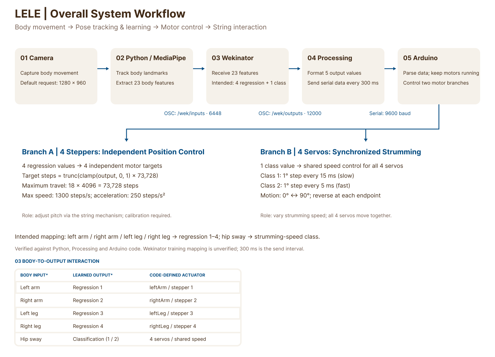

# Software Design

## 1. Software Overview

Lele uses a modular software system to translate body movements into mechanical responses. The system connects Python, Wekinator, Processing and Arduino through OSC and serial communication.

Each program handles a different stage of the process, allowing us to develop and test individual components before integrating the complete system.

## 2. System Architecture

### Overall System Workflow

The system follows four main stages:

| Stage | Software | Function |
|---|---|---|
| 1. Body Tracking | Python + MediaPipe | Detects body landmarks and calculates body-relative movement features |
| 2. Movement Mapping | Wekinator | Converts movement features into four regression outputs and one classification output |
| 3. Data Communication | Processing | Receives OSC outputs and sends serial commands to Arduino |
| 4. Motor Control | Arduino | Converts control values into stepper and servo motor movements |

## 3. Software Implementation

### 3.1 Python — Body Tracking

Python uses OpenCV to capture webcam input and MediaPipe Pose to detect body landmarks.

Instead of using only raw screen coordinates, we calculate body-relative coordinates based on anatomical reference points and shoulder width. This helps reduce the influence of camera position and user distance.

The processed movement features are sent to Wekinator through OSC.

### 3.2 Wekinator — Movement Mapping

Wekinator maps the incoming body movement features to five control outputs:

- Four regression outputs control the target positions of the four stepper motors.
- One classification output controls the strumming behaviour of the servo motors.

The training process and model configuration are documented separately in `04_Machine_Learning.md`.

### 3.3 Processing — Data Communication

Processing acts as a bridge between Wekinator and Arduino.

It receives five OSC outputs, stores the latest values and sends them to Arduino as serial data approximately every 300 ms.

This interval helps limit repeated serial commands while maintaining a responsive interaction.

### 3.4 Arduino — Motor Control

Arduino receives the serial control values and updates the motor movements.

The AccelStepper library controls the four stepper motors using target positions, speed and acceleration settings. The Servo library controls the four SG90 servo motors.

The stepper motors are controlled independently, allowing different limb movements to produce different pitch adjustments.

## 4. Communication Settings

| Connection | Protocol / Setting |
|---|---|
| Python → Wekinator | OSC, port 6448, `/wek/inputs` |
| Wekinator → Processing | OSC, port 12000, `/wek/outputs` |
| Processing → Arduino | Serial, 9600 baud |
| Serial update interval | Approximately 300 ms |

The modular communication structure also supports debugging: each stage can be checked independently to identify where data transmission or motor control fails.

For installation instructions, startup order and troubleshooting, see `Installation_and_Startup.md`.
