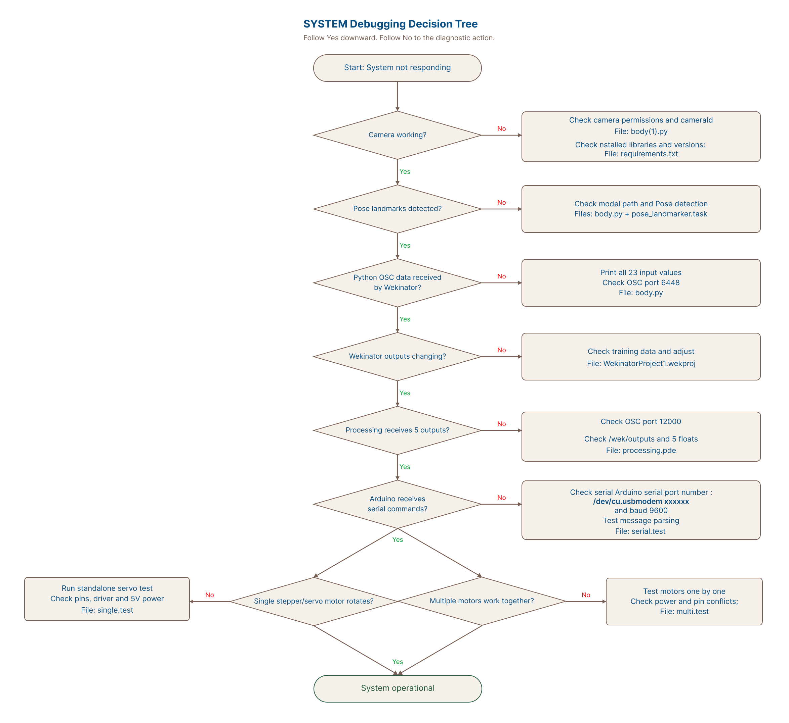

# Testing and Debugging

## 1. Testing Strategy

We tested Lele in stages, starting with individual components before integrating the complete system.

| Test | Method | Result |
|---|---|---|
| Body Tracking | Test different limb movements in front of the webcam | Body landmarks detected and tracked |
| OSC Communication | Check whether Wekinator receives Python input data | OSC communication established |
| Machine Learning | Test regression and classification outputs separately | Outputs respond to body movements |
| Single Motor | Run standalone stepper and servo tests | Individual motors operate |
| Multiple Motors | Run four steppers and four servos together | Combined motor control tested successfully |
| Full System | Connect Python, Wekinator, Processing and Arduino | Body movements translated into mechanical responses |

## 2. Debugging Process

During development, we encountered several technical challenges.

**Motor Control and Power**

Running multiple motors simultaneously increased the power demand. We tested the motors individually before combining them and adjusted the motor speed and rotation range to improve system performance.

**Serial Communication**

Processing and Arduino need to use the same baud rate (9600). We also checked the correct serial port and closed the Arduino Serial Monitor to avoid port conflicts.

**Body Tracking**

MediaPipe detection could become unstable when body landmarks were obscured or moved outside the camera's view. We used body-relative coordinates to reduce the influence of camera position and user distance.

**System Responsiveness**

We adjusted the serial update interval to approximately 300 ms to reduce unnecessary repeated commands. Some response delay remains because of the communication stages and the time required for motors to reach their target positions.

## 3. Debugging Decision Tree

The following diagram provides a step-by-step troubleshooting guide for identifying problems in the complete system.

The diagram follows the data flow from camera detection to motor operation. When a stage fails, the corresponding diagnostic action identifies the relevant code, communication settings or hardware connections to check.

## 4. Current Limitations

Although the complete system operates, several limitations remain:

- Body tracking may become unstable when the participant is partially obscured.
- Rapid movements may produce delayed mechanical responses.
- Simultaneous motor operation requires sufficient and stable power.
- Movement mappings may respond differently to users with different body proportions and movement habits.

These limitations provide directions for future improvements in tracking stability, motor performance and system responsiveness.
